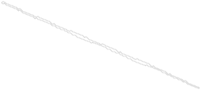

# A 622-square polyomino that folds into five different boxes

Folds into five boxes: **1×2×103**, **2×3×61**, **2×5×43**, **2×7×33**, **2×13×19**

**Net A** is a polyomino of **622 unit squares** that folds, along grid lines only, onto the surfaces of these five
boxes, and onto none of the other 14 boxes of surface area 622. It can also be folded physically, one fold line at a
time, without the paper passing through itself ([Physical folding](#physical-folding)). 622 is the smallest area of a
five-box net found so far in this work, **not claimed to be minimal**; for comparison, the five-box net of [2] has 2128
squares. Not peer reviewed; corrections are welcome as issues.



3-D viewer: [`viewer/index.html`](viewer/index.html). Download it and open it in a browser (one file, works offline).
It folds net A into each of the five boxes in turn. All fold lines turn together, so parts of the paper pass through
each other; this is not a physical folding sequence (one is described in [Physical folding](#physical-folding)).

Two more 622-square nets with the same five boxes, **net B** and **net C**, are given as cell lists only, without
figures: [`data/net-622-b-cells.txt`](data/net-622-b-cells.txt), [`data/net-622-c-cells.txt`](data/net-622-c-cells.txt).
They have the same strip direction, period and fifth folding as net A and differ from it in the shape of the strip and
the corners (18 and 20 squares); none of the three is a rotation or reflection of another. Five-box nets at other areas
are listed [below](#more-five-box-nets).

**Not a complete list.** All these nets were found by one method (see Construction). They are examples, not all five-box
nets. Listing all of them would need a full search, which is out of reach: for area 622 alone, about 83 000 parameter
sets of the method pass the notch-and-tab check, and each allows many shapes of the strip. There are probably more
622-square five-box nets. Below 622 the method found none (designs at areas 352, 496, 532 and 592 gave no strip of the
needed shape), but five-box nets of smaller area built in another way are not excluded.

## What is new

This work builds on two nets by Reed Silverstein and Conner Silverstein, the 532-square four-box net [1] and the
2128-square five-box net [2], and on the 352-square four-box nets [4].

**From earlier work:**

- Four foldings of one strip: its two ends are glued to each other, and each long edge is glued to itself by one of
  two reflections, which gives four flat "pillowcases" [1]; the edges need an odd number of periods [4].
- Notches and tabs that turn the corners of a pillowcase into box corners [1], and an exact integer program that places
  them [4].
- A five-box net, of 2128 squares [2], which shows that a fifth box beyond the four strip foldings is possible.
- The `CheckNet.java` driver for the checker [3], the folding-data format and the rigid folding simulation [1].

**New here:**

- Five-box nets of 622 squares: net A (shown), nets B and C (cell lists).
- The form of the fifth folding: it keeps one reflection on each edge and moves the translation that glued the two
  ends onto the edges. The fifth folding of the 2128 net [2] has the same form.
- A rule, found by computation and not proved: the corners of the fifth folding fit together when its translation is
  shifted by k/(2k + 1) of a lattice vector of the strip (1/3, 2/5, 3/7, …), never by 1/2. Every five-box net found has
  the shift 1/3.
- A method that designs the strip and all five foldings together: the shape of the strip is computed by a constraint
  solver, not drawn as a straight band.

## Check it yourself

```
python3 verify/verify_folds.py data/net-622-a-cells.txt
python3 verify/verify_folds.py data/net-622-b-cells.txt
python3 verify/verify_folds.py data/net-622-c-cells.txt
```

Python 3 standard library only, about 30 seconds per net. The script tests all 19 boxes of surface area 622 and prints
which ones the net folds into: for all three nets, exactly the five boxes above. The same result was obtained with
`ValidNetSolutionChecker` [3], run through `verify/CheckNet.java` (see [`verify/README.md`](verify/README.md)).

## Physical folding

The checks above concern the folded state. That the nets can also be folded physically was checked with the rigid
folding simulation of [1] (`simulate_folding.py`, MIT), adapted only to read the face of every square from
`verify_folds.py`. For each box, the squares that land on one face and touch form a flat, rigid panel. The fold lines
are turned one at a time from 0° to 90°, starting from square (0, 109) at the left end of the strip (net B: (0, 108)),
and every position at 0.5° steps is tested for two squares passing through each other (squares shrunk by 0.5% about
their centres, so that squares that only touch do not count). Result: **no collisions** for any of the five boxes of
nets A, B and C (317, 303 and 317 fold lines; 57 060, 54 540 and 57 060 positions), both when the fold lines nearest
the start are turned first and when the farthest are. Starting from the middle of the strip, at least four of the five
boxes collide, so the order matters and the test detects collisions. The paper is assumed to have no thickness.

## Construction

**Four strip foldings.** The strip runs in direction (7, −3). Its two ends are glued to each other, and each long edge
is glued to itself by one of two reflections; the bottom edge has 3 periods and the top edge 5. The four combinations
fold the strip onto four pillowcases. Notches and tabs at the corners turn a pillowcase A × B into a box
2 × (A − 2) × (B − 2).

**The fifth folding.** It keeps one reflection on each long edge. The gluing of the two ends is moved onto
the edges, as a short pair next to the kept reflections, and each end becomes part of a new reflection together with a
piece of an edge. This folds the same strip onto a fifth pillowcase. If ⟨τ, s⟩ is the lattice of the kept strip
folding (τ along the strip), the fifth folding has the lattice ⟨τ + s/3, s⟩: its translation is shifted by s/3.

| Folding | Pillowcase | Box |
|---|---|---|
| strip | 3×105 | 1×2×103 |
| strip | 7×45 | 2×5×43 |
| strip | 9×35 | 2×7×33 |
| strip | 15×21 | 2×13×19 |
| fifth | 5×63 | 2×3×61 |

All five pillowcases have A·B = 315, so all five boxes have surface area 2 · 315 − 8 = 622. They are all the boxes of
area 622 that have a side 2.

**How the strip was found.** A strip in direction (7, −3) cannot be cut as a straight band from the square grid in the
way of [1] and [4]: its corner points would fall on edge midpoints. Instead the boundary of the strip is computed:

1. choose the strip's period, end length and the shift so that all five pillowcases are rectangles of the right size;
2. find, with a constraint solver (CP-SAT), a boundary that satisfies all five gluings, closes into a simple polygon
   and is as thick as possible;
3. place notches and tabs with the exact integer program of [4], so that every folding covers its box exactly once.

Details: [`docs/construction.md`](docs/construction.md). The search programs are in
[multi-box-nets](https://github.com/ro-novikov/multi-box-nets).

<!-- table:start (generated by common/build_five_box.py) -->
## More five-box nets

The same method gave five-box nets at other areas. The table lists one net for each set of boxes found; each was checked
with `ValidNetSolutionChecker` [3] against every box of its surface area and folds into exactly the five boxes listed.
All have the shift 1/3. These are examples, not a complete list. The nets and the programs are in
[multi-box-nets](https://github.com/ro-novikov/multi-box-nets). The table is also in
[`data/five-box-nets.csv`](data/five-box-nets.csv).

| Area | Boxes of the four strip foldings | Fifth box | Common side | Note |
|---:|---|---|---:|---|
| 622 | 1×2×103, 2×5×43, 2×7×33, 2×13×19 | 2×3×61 | 2 | nets A, B and C (this repository) |
| 1228 | 2×4×101, 3×4×86, 4×14×31, 4×17×26 | 4×6×59 | 4 |  |
| 1408 | 2×4×116, 4×4×86, 4×14×36, 4×20×26 | 4×6×68 | 4 | design: the lattice of the 352 nets [4] at double scale |
| 1588 | 2×4×131, 4×5×86, 4×14×41, 4×23×26 | 4×6×77 | 4 | design chosen in advance by the 1/3 rule |
| 1768 | 1×4×176, 4×8×71, 4×11×56, 4×21×32 | 4×16×41 | 4 | design chosen in advance by the 1/3 rule |
| 1858 | 3×4×131, 4×5×101, 4×17×41, 4×23×31 | 4×11×59 | 4 | design chosen in advance by the 1/3 rule |
| 1948 | 2×4×161, 4×7×86, 4×14×51, 4×26×29 | 4×6×95 | 4 | design chosen in advance by the 1/3 rule |
| 2128 | 2×4×176, 4×8×86, 4×14×56, 4×26×32 | 4×6×104 | 4 | design based on the lattice of [2]: same four strip boxes, another fifth box |
<!-- table:end -->

## Data

`data/`: net A (cells, cut outline, folding data), nets B and C (cells) and the table of five-box nets. Formats:
[`docs/FORMAT.md`](docs/FORMAT.md).

## References

1. R. Silverstein, C. Silverstein, [four-box-net-532](https://github.com/Sprite143/four-box-net-532), 2026: a
   532-square net that folds into four boxes, and how it was found.
2. C. Silverstein, R. Silverstein, [five-box-net-2128](https://github.com/Sprite143/five-box-net-2128), 2026: a
   2128-square net that folds into five boxes.
3. [hidny/CuboidSimplePhaseNetSearch](https://github.com/hidny/CuboidSimplePhaseNetSearch): `ValidNetSolutionChecker`.
4. R. Novikov, [four-box-net-352](https://github.com/ro-novikov/four-box-net-352), 2026: 352-square four-box nets, the
   strip construction for any direction, and its rules.

Related work:

- T. Shirakawa, R. Uehara, *Common developments of three different orthogonal boxes*, CCCG 2012, pp. 17–21: the first
  polygon that folds into three boxes of positive volume (area 1792), and an infinite family. Journal version:
  *Common developments of three incongruent orthogonal boxes*, Int. J. Comput. Geom. Appl. 23(1) (2013) 65–71.
- Z. Abel, E. Demaine, M. Demaine, H. Matsui, G. Rote, R. Uehara, *Common developments of several different orthogonal
  boxes*, CCCG 2011, pp. 77–82: a long strip folds into any number of flat boxes.
- L. Qian, E. Wang, B. Subercaseaux, M. J. H. Heule, *Unfolding boxes with local constraints*, 2025,
  [arXiv:2506.01079](https://arxiv.org/abs/2506.01079).
- Demaine, Diomidova, Jacobus, Kryger, Parker, Tardibuono, Uehara, Zhang, *Polyomino nets covering three different
  boxes of area 106 and related results*, 2026, [arXiv:2608.19910](https://arxiv.org/abs/2608.19910).

## Credits

The search and the write-up were done with Claude Opus 5.5 (Anthropic).

## License

Code (`*.py`, `*.java`, `viewer/index.html`) is released under the MIT License; data, figures and write-ups under
CC BY 4.0 (see [`LICENSE`](LICENSE)). `verify/CheckNet.java` is from [1] (MIT).

## Citing

Rodion Novikov, *A 622-square polyomino that folds into five different boxes*, 2026,
https://github.com/ro-novikov/five-box-net-622
